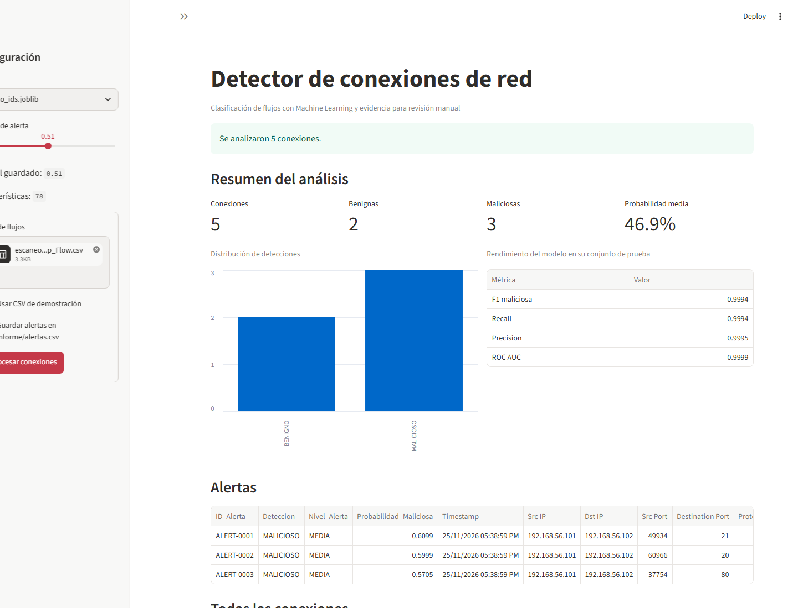

# Detector de conexiones maliciosas con Machine Learning

Proyecto académico que entrena un modelo con datos de **CIC-IDS2017**, convierte capturas de red en características con **CICFlowMeter** y clasifica cada flujo como `BENIGNO` o `MALICIOSO` mediante un tablero en **Streamlit**.

La demostración utiliza una sola computadora: Windows como PC 1 y una VM Kali como PC 2, conectadas por una red VirtualBox **solo anfitrión** y aislada de Internet.

> Estado: el modelo, el tablero, las pruebas y las evidencias del laboratorio están incluidos. El dataset original, las VM y los instaladores no se distribuyen en GitHub porque son archivos muy grandes.

## Qué hace el proyecto

```text
Kali (tráfico de laboratorio)
        |
        | red aislada 192.168.56.0/24
        v
Windows: servicio HTTP + Wireshark/tcpdump
        |
        v
PCAP --> CICFlowMeter --> CSV de flujos
                              |
                              v
                 Random Forest + Streamlit
                              |
                              v
                 BENIGNO / MALICIOSO + alertas
```

El tablero funciona con archivos CSV. **No es un IDS en tiempo real ni bloquea ataques**: analiza flujos previamente capturados y convertidos.

## Resultados incluidos

### Modelo entrenado con CIC-IDS2017

| Métrica | Resultado |
|---|---:|
| Flujos de prueba | 21.629 |
| Exactitud | 99.9168 % |
| Precisión maliciosa | 99.9490 % |
| Recall malicioso | 99.9363 % |
| F1 maliciosa | 99.9427 % |
| ROC AUC | 99.9942 % |
| PR AUC | 99.9977 % |

Matriz de confusión:

```text
                 Predicción BENIGNO  Predicción MALICIOSO
Real BENIGNO              5921                  8
Real MALICIOSO             10              15690
```

El modelo final es `modelos/modelo_ids.joblib`, usa 78 características y un umbral de `0.5097023376315192`.

### Demostración con tráfico propio

| Caso | Flujos | Benignos | Maliciosos |
|---|---:|---:|---:|
| Tráfico normal | 10 | 10 | 0 |
| Escaneo autorizado | 5 | 2 | 3 |

El escaneo generó alertas en los puertos 20, 21 y 80. Los flujos hacia 8080 y 443 quedaron por debajo del umbral; por eso no se afirma que el modelo detectó el 100 % del escaneo.



## Inicio rápido en Windows

### Requisitos

- Windows 10 u 11.
- Python 3.12. El entorno usado y verificado es Python 3.12.15.
- Git para clonar el repositorio.
- Alrededor de 1 GB libres para el entorno virtual y las dependencias.
- No hace falta Kali, Wireshark ni Npcap para probar los CSV incluidos.

### 1. Clonar y entrar al proyecto

```bat
git clone <URL-DEL-REPOSITORIO>
cd <NOMBRE-DEL-REPOSITORIO>
```

### 2. Crear el entorno e instalar dependencias

Abrir CMD en la carpeta del repositorio:

```bat
py -3.12 -m venv .venv
.venv\Scripts\python.exe -m pip install --upgrade pip
.venv\Scripts\python.exe -m pip install -r requirements.txt
```

Si el comando `py` no está disponible, usar el ejecutable de Python 3.12 instalado:

```bat
python -m venv .venv
```

`requirements-lock.txt` contiene además todas las versiones transitivas exactas del entorno verificado. Para reproducirlo de forma estricta, sustituir `requirements.txt` por `requirements-lock.txt` en el comando de instalación.

### 3. Ejecutar las pruebas

```bat
.venv\Scripts\python.exe -m pytest -q
```

Resultado esperado: **7 pruebas aprobadas**.

### 4. Abrir el tablero

```bat
.venv\Scripts\python.exe -m streamlit run src/app.py
```

Abrir en el navegador:

**http://127.0.0.1:8501**

También se puede hacer doble clic en `herramientas\abrir_tablero.bat` después de instalar las dependencias. Para detener el servidor, cerrar su ventana o pulsar `Ctrl + C` en la terminal.

## Probar el modelo con las evidencias incluidas

1. Abrir el tablero.
2. Dejar seleccionado `modelo_ids.joblib`.
3. Dejar el umbral en `0.51`.
4. Cargar `datos\procesados\normal\normal.pcap_Flow.csv`.
5. Pulsar **Procesar conexiones**. Deben aparecer 10 conexiones benignas.
6. Cargar `datos\procesados\escaneo\escaneo.pcap_Flow.csv`.
7. Pulsar **Procesar conexiones**. Deben aparecer 5 conexiones y 3 alertas.
8. Revisar las IPs, puertos y probabilidades de la tabla **Alertas**.

El modelo sintético `modelos/modelo_demo.joblib` y `datos/demo/demo_flujos.csv` sirven únicamente para probar la interfaz. No deben presentarse como resultados del dataset CIC.

## Estructura del repositorio

```text
.
├── src/                         Código del modelo, datos, reportes y tablero
│   ├── app.py                   Aplicación Streamlit
│   ├── data.py                  Carga, limpieza, mapeo y separación por grupos
│   ├── model.py                 Random Forest, umbral y predicción
│   ├── train.py                 Entrenamiento del modelo final
│   ├── evaluate.py              Evaluación de un CSV etiquetado
│   ├── generar_demo.py          Datos y modelo sintéticos
│   └── reporting.py             Métricas y gráficos
├── tests/                       Pruebas automatizadas
├── modelos/                     Modelo real y modelo sintético
├── datos/
│   ├── demo/                    Datos sintéticos y muestra real pequeña
│   ├── procesados/normal/       CSV real del tráfico normal
│   ├── procesados/escaneo/      CSV real del escaneo
│   └── originales/              Vacío en Git; aquí se extrae CIC-IDS2017
├── capturas/                    PCAP reales del laboratorio
├── informe/                     Métricas, gráficos, alertas y predicciones
├── herramientas/                Lanzadores y servidor HTTP de laboratorio
├── .streamlit/config.toml       Configuración local y sin telemetría
├── guia_laboratorio_deteccion_conexiones.md
├── requirements.txt
├── requirements-lock.txt
└── .python-version
```

Más detalles en [datos/README.md](datos/README.md), [herramientas/README.md](herramientas/README.md) e [informe/README.md](informe/README.md).

## Reentrenar el modelo

El dataset original no está incluido. Descargar `MachineLearningCSV.zip` desde la página oficial de CIC-IDS2017 y extraerlo en `datos/originales/MachineLearningCVE/`:

- https://www.unb.ca/cic/datasets/ids-2017.html
- http://cicresearch.ca/CICDataset/CIC-IDS-2017/

El ZIP usado originalmente tiene SHA-256:

```text
c3f26274b36c837ccf28ffd2dbf4582941c30b3ee70a635c6e5b2f87c4727928
```

Para reproducir el entrenamiento documentado, abrir **Git Bash** en la raíz del proyecto y ejecutar:

```bash
.venv/Scripts/python.exe -m src.train \
  --input "datos/originales/MachineLearningCVE/Monday-WorkingHours.pcap_ISCX.csv" \
  "datos/originales/MachineLearningCVE/Tuesday-WorkingHours.pcap_ISCX.csv" \
  "datos/originales/MachineLearningCVE/Wednesday-workingHours.pcap_ISCX.csv" \
  "datos/originales/MachineLearningCVE/Friday-WorkingHours-Afternoon-PortScan.pcap_ISCX.csv" \
  --max-rows-per-label 30000 \
  --dataset-output "datos/procesados/dataset_listo.csv" \
  --model-output "modelos/modelo_ids.joblib" \
  --report-output "informe"
```

El entrenamiento puede tardar varios minutos y usar bastante memoria. El límite de 30.000 filas por etiqueta reduce el consumo sin cambiar el código.

## Repetir el laboratorio de red

La guía completa está en [guia_laboratorio_deteccion_conexiones.md](guia_laboratorio_deteccion_conexiones.md). El flujo resumido es:

1. Crear una red VirtualBox **solo anfitrión**.
2. Configurar Windows en `192.168.56.102/24` y Kali en `192.168.56.101/24`, sin gateway ni DNS en Kali.
3. Iniciar `herramientas\servidor_laboratorio.ps1` en Windows.
4. Capturar tráfico normal y un escaneo pequeño desde Kali.
5. Convertir los PCAP con CICFlowMeter.
6. Cargar los CSV en el tablero y comparar las alertas con las capturas.

Las pruebas ofensivas deben ejecutarse **solamente contra la IP del laboratorio aislado**. No usar el escaneo contra redes externas.

Para esta parte se necesitan VirtualBox, Kali, Wireshark, Npcap, Java 8 y CICFlowMeter. Sus instaladores, la VM y los binarios compilados no están incluidos; consultar [herramientas/README.md](herramientas/README.md).

## Archivos que no se suben a GitHub

El archivo `.gitignore` excluye:

- `.venv/`, cachés de Python y registros.
- `vm/`: la VM Kali y sus instaladores.
- `datos/originales/`: el dataset completo de más de 1 GB.
- `datos/procesados/dataset_listo.csv`: CSV procesado de 44 MB.
- `herramientas/CICFlowMeter/` y `herramientas/CICFlowMeter-instalado/`: código de terceros y binarios compilados.
- Capturas de pantalla personales de escritorio.
- Archivos `.env`, secretos, instaladores, ZIP, OVA y discos de VM.

Sí se incluyen el modelo final, los CSV pequeños del laboratorio, los PCAP, las métricas y las capturas del tablero.

## Interpretación y limitaciones

- Las métricas altas corresponden al conjunto de prueba de CIC-IDS2017, no a cualquier red real.
- La demostración propia usa pocos flujos y no detecta todos los intentos del escaneo.
- Un `MALICIOSO` indica sospecha y prioridad de revisión; no prueba por sí solo que exista un ataque.
- Cambiar el umbral modifica la cantidad de alertas y los falsos positivos.
- El modelo no contiene IPs ni nombres de usuario como características de decisión; las IPs se muestran como evidencia del flujo.

## Solución de problemas

### El tablero no inicia

Comprobar que el entorno virtual existe:

```bat
dir .venv\Scripts\python.exe
```

Si no existe, repetir la instalación del apartado **Inicio rápido**.

### Error al cargar el modelo

Usar las versiones de `requirements.txt`. Un modelo de scikit-learn puede ser incompatible con una versión distinta. El modelo incluido se entrenó con scikit-learn 1.9.1 y Python 3.12.15.

### El CSV no es compatible

El tablero espera las 78 características de `modelos/modelo_ids.joblib`. Usar los CSV incluidos o convertir un PCAP con CICFlowMeter. El mapeo de nombres entre CICFlowMeter y CIC-IDS2017 se aplica automáticamente en `src/data.py`.

### El puerto 8501 está ocupado

Cerrar otra ventana de Streamlit o ejecutar:

```bat
.venv\Scripts\python.exe -m streamlit run src/app.py --server.port 8502
```

Después abrir `http://127.0.0.1:8502`.

## Antes de compartir o actualizar Git

1. Ejecutar `git status` y revisar los archivos nuevos.
2. No subir credenciales, capturas de escritorio personales, VM ni instaladores.
3. Ejecutar las pruebas antes de crear un commit.
4. Si se modifica el modelo, actualizar también las métricas y las evidencias relacionadas.

## Créditos y fuentes

- Canadian Institute for Cybersecurity, CIC-IDS2017: https://www.unb.ca/cic/datasets/ids-2017.html
- CICFlowMeter: https://github.com/ISCX/CICFlowMeter
- scikit-learn: https://scikit-learn.org/
- Streamlit: https://streamlit.io/

Proyecto de uso académico. Antes de redistribuir datasets o herramientas de terceros, revisar sus licencias y condiciones de uso.
